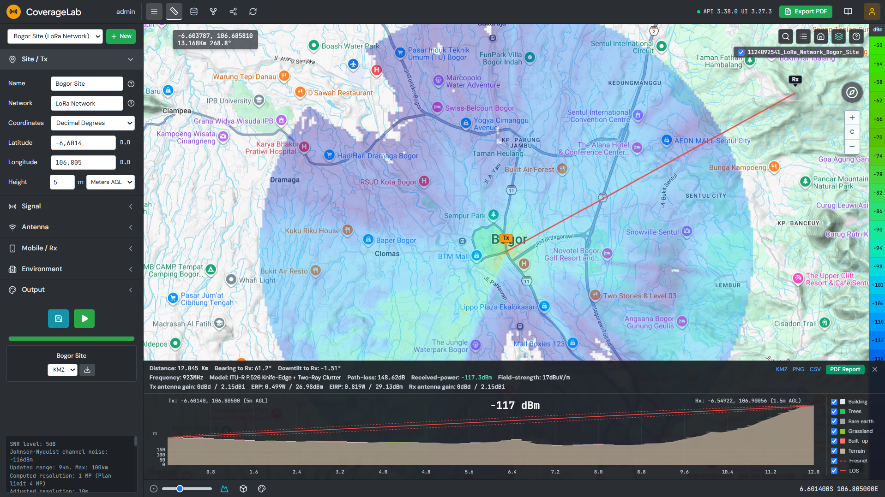
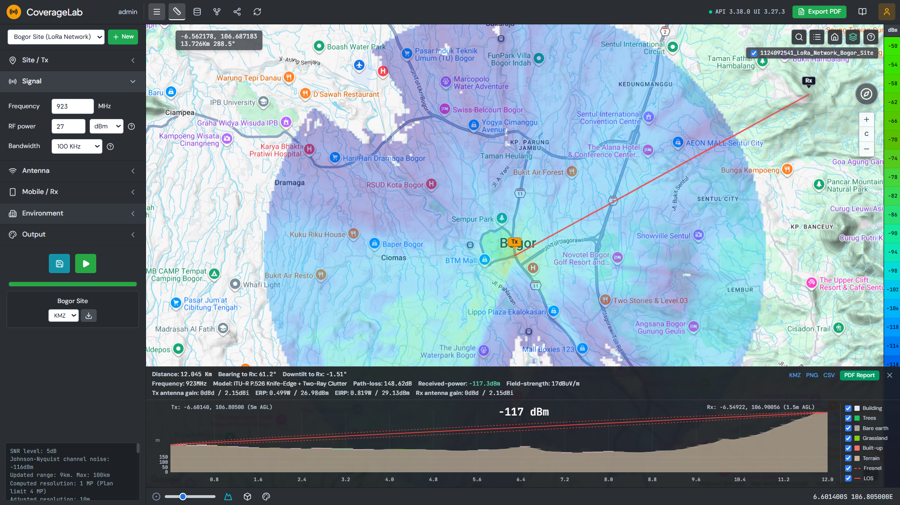
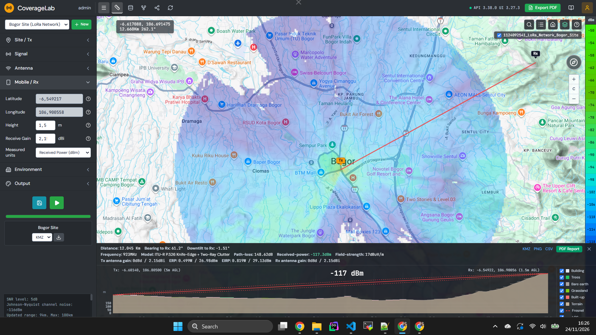
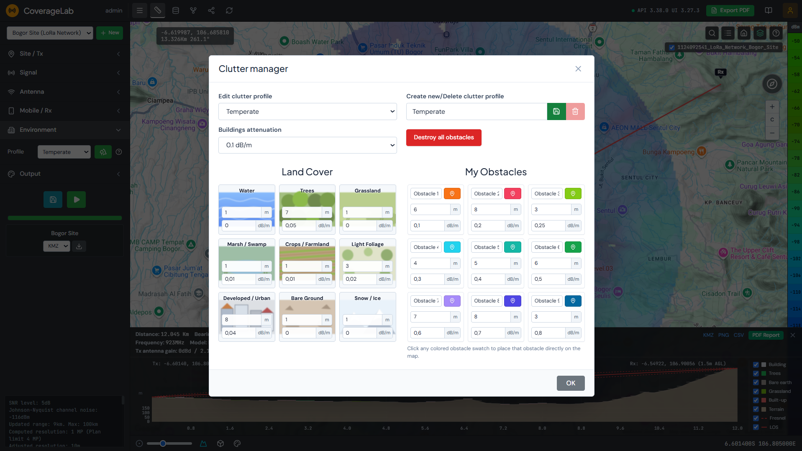
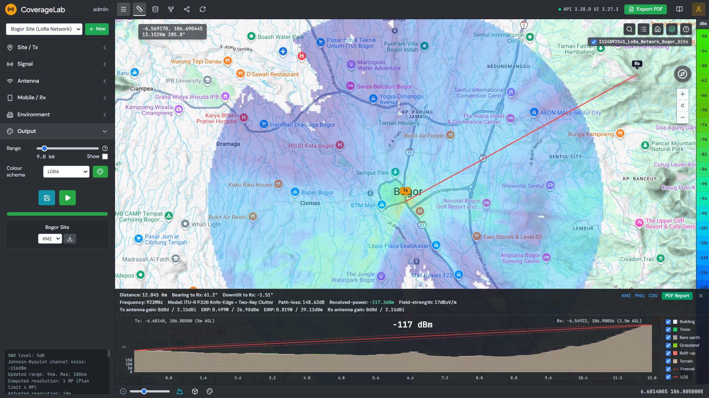
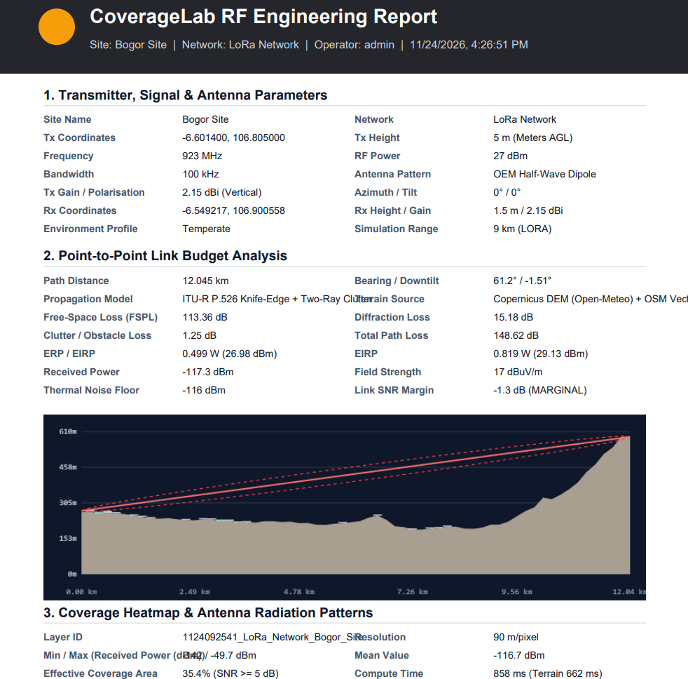
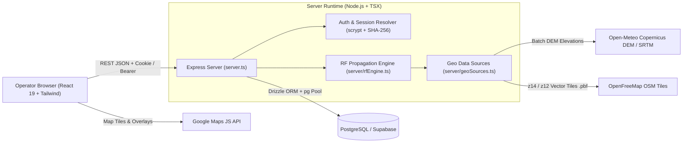

<div align="center">

# CoverageLab

**Deterministic RF Signal Propagation Simulator, Map-Based Coverage Heatmap Planner & Link Budget Workbench**

[](https://react.dev/)
[](https://www.typescriptlang.org/)
[](https://vite.dev/)
[](https://expressjs.com/)
[](https://www.postgresql.org/)
[](https://orm.drizzle.team/)
[](https://tailwindcss.com/)
[](https://developers.google.com/maps)
[](#system-architecture)

</div>

---

<p align="center">
  
</p>

<table>
  <tr>
    <td width="33.33%" align="center">
      
      <br />
      <sub><strong>Create New RF Site</strong></sub>
    </td>
    <td width="33.33%" align="center">
      
      <br />
      <sub><strong>Signal &amp; Bandwidth Configuration</strong></sub>
    </td>
    <td width="33.33%" align="center">
      
      <br />
      <sub><strong>Mobile / Rx &amp; Link Budget</strong></sub>
    </td>
  </tr>
  <tr>
    <td width="33.33%" align="center">
      
      <br />
      <sub><strong>Clutter Manager &amp; Obstacles</strong></sub>
    </td>
    <td width="33.33%" align="center">
      
      <br />
      <sub><strong>Range Radius &amp; Colour Schemas</strong></sub>
    </td>
    <td width="33.33%" align="center">
      
      <br />
      <sub><strong>Structured RF PDF Report</strong></sub>
    </td>
  </tr>
</table>

---

## Key Capabilities

- **Physics-Based RF Engine (`ITU-R P.526` + Two-Ray Breakpoint):** Computes Free-Space Path Loss, $k=4/3$ Earth curvature bulge, cumulative knife-edge diffraction over terrain & buildings, frequency-scaled clutter attenuation, 3D antenna radiation patterns (horizontal azimuth + vertical tilt), Johnson-Nyquist thermal noise floor, and Web Mercator-exact `200×200` coverage rasters.
- **Real Terrain & Urban Clutter:** Integrates **Copernicus DEM** (Open-Meteo with NASA SRTM 30m fallback) for elevation profiles alongside **OpenFreeMap OSM Vector Tiles** (`z14` real building footprints/`render_height`, forests, water, parks; `z12` macro landuse).
- **Multi-Unit Visualization:** Switch seamlessly between `Received Power (dBm)`, `SNR (dB)`, `Field Strength (dBuV/m)`, and `Path Loss (dB)` with scalar-field bilinear upsampling and dynamic palette legends.
- **Interactive GIS Tools:** Point-to-Point **Path Profile & Fresnel Zone** drawer (auto-fitting across desktop & fullscreen), **Multipoint Link** tester, **Mesh / MANET** node planner, custom **Clutter & Obstacle** placement, and **Google Maps** multi-basemap controls.
- **PostgreSQL Persistence & Export:** Full session auth (`HttpOnly` cookie + Bearer token), site CRUD (`+ New Site`, templates, saved layers), and exports in **PDF**, **KMZ/KML**, **PNG**, and **CSV**.

---

## Project Structure

```text
coveragelab/
├── docs/                           # Showcase screenshots & documentation assets
├── drizzle/                        # Drizzle Kit generated SQL migrations
├── server/
│   ├── geoSources.ts               # Copernicus DEM / SRTM fetcher & OpenFreeMap PBF rasterizer
│   └── rfEngine.ts                 # ITU-R P.526 diffraction, two-ray clutter & coverage grid engine
├── src/
│   ├── components/
│   │   ├── AuthModal.tsx           # Operator login / registration dialog
│   │   ├── ClutterManagerModal.tsx # Land cover & custom obstacle attenuation editor
│   │   ├── HelpDocsModal.tsx       # RF modeling & quick-start documentation modal
│   │   ├── LandCoverIllustrations.tsx # Custom land cover visual tiles
│   │   ├── LeftSidebar.tsx         # Collapsible left menu rail & full parameter accordion
│   │   ├── NewSiteModal.tsx        # Create New RF Site modal (fresh defaults or clone)
│   │   ├── PathProfileDrawer.tsx   # Responsive SVG terrain, Fresnel & LOS profile chart
│   │   ├── PolarDiagram.tsx        # Horizontal & vertical antenna polar pattern plotters
│   │   ├── RfMapCanvas.tsx         # Google Maps viewport, GroundOverlay, markers & HUD
│   │   └── SavedLayersModal.tsx    # Stored sites & PostgreSQL simulation layer browser
│   ├── db/
│   │   ├── index.ts                # pg Pool & Drizzle ORM client initialization
│   │   ├── schema.ts               # PostgreSQL tables (users, sessions, projects, sims, etc.)
│   │   └── seed.ts                 # Default antenna patterns, clutter profiles & site presets
│   ├── lib/
│   │   ├── colourSchemas.ts        # 20 RF colour palettes & unit-aware stop interpolation
│   │   ├── exportUtils.ts          # Structured jsPDF report, KMZ/KML, PNG & CSV exporters
│   │   └── geoUtils.ts             # Geodesic helpers & bilinear scalar rasterizer
│   ├── types/
│   │   └── rf.ts                   # Shared frontend/backend TypeScript DTO definitions
│   ├── App.tsx                     # Root workspace state, toolbar & modal orchestration
│   ├── index.css                   # Tailwind CSS v4 entry & custom dark scrollbar/slider styles
│   └── main.tsx                    # React 19 DOM entry point
├── drizzle.config.ts               # Drizzle Kit PostgreSQL configuration
├── index.html                      # HTML entry point & metadata
├── package.json                    # Scripts & dependency manifest
├── server.ts                       # Express API server, auth middleware & Vite SSR/dev host
├── tsconfig.json                   # TypeScript compiler configuration
└── vite.config.ts                  # Vite bundler & Tailwind plugin setup
```

---

## System Architecture



### Layer Breakdown

1. **Presentation Layer (`src/`):** Single-page React 19 workspace rendered with `@vis.gl/react-google-maps`. Coverage heatmaps (`gridValues` array) are bilinearly resampled in scalar space (`200×200 → 400×400`) into transparent PNG `GroundOverlay` layers on Web Mercator bounds.
2. **API & Auth Layer (`server.ts`):** Express serves both REST endpoints (`/api/bootstrap`, `/api/projects`, `/api/rf/simulate`, `/api/rf/path-profile`, `/api/multipoint`, `/api/mesh`, `/api/clutter-profiles`, `/api/obstacles`, `/api/geocode/search`) and the Vite dev middleware / static `dist/` bundle on port `3000`. Passwords use `scrypt` with random salts, and sessions are persisted in PostgreSQL via SHA-256 hashed tokens (`HttpOnly` cookie + Bearer header).
3. **RF & Geospatial Engine (`server/rfEngine.ts`, `server/geoSources.ts`):**
   - `computeCoverageGrid` evaluates `180` radial bearings × `96` rings (`~30 m` clutter sub-sampling) over cached DEM elevations and rasterized OSM building/tree/water layers, then projects onto a Web Mercator `200×200` raster.
   - `computePathProfile` performs point-to-point terrain, Fresnel zone (`F1`), LOS, and link budget analysis for interactive inspection and PDF/CSV reporting.
4. **Persistence Layer (`src/db/`):** Drizzle ORM manages relational tables (`users`, `sessions`, `antenna_patterns`, `clutter_profiles`, `rf_projects`, `simulations`, `placed_obstacles`, `multipoint_links`, `mesh_nodes`) in PostgreSQL.

---

## Tech Stack

| Layer | Technology |
| :--- | :--- |
| **Frontend UI** | React 19, TypeScript, Tailwind CSS v4, Lucide Icons, Motion |
| **Mapping & GIS** | Google Maps Platform (`@vis.gl/react-google-maps`), Web Mercator Canvas Rasterizer |
| **Backend API** | Node.js, Express 4, TSX |
| **Database & ORM** | PostgreSQL (Supabase Pooler), Drizzle ORM (`drizzle-orm` / `drizzle-kit`), `pg` |
| **Elevation & Clutter** | Open-Meteo Copernicus DEM, OpenTopoData NASA SRTM 30m, OpenFreeMap `.pbf` (`@mapbox/vector-tile`, `pbf`), OSM Nominatim |
| **Reporting & Export** | jsPDF (structured multi-section RF reports), KML/KMZ, PNG, CSV |

---

## How to Build

### 1. Prerequisites

- **Node.js** `>= 20.x`
- **PostgreSQL** database (e.g., Supabase or local Postgres)
- **Google Maps Platform API Key** with Maps JavaScript API enabled

### 2. Configure Environment Variables

Copy `.env.example` to `.env` and fill in your credentials:

```bash
cp .env.example .env
```

```env
# PostgreSQL Connection (Drizzle ORM)
DB_HOST=your-postgres-host
DB_PORT=5432
DB_NAME=postgres
DB_USER=your-postgres-user
DB_PASSWORD=your-postgres-password

# Google Maps Platform API Key
GOOGLE_MAPS_API_KEY=your_google_maps_api_key

# Optional runtime metadata
APP_URL=http://localhost:3000
```

### 3. Install Dependencies & Push Database Schema

```bash
npm install
npm run db:push
```

### 4. Verify TypeScript & Build Production Bundle

```bash
npm run lint
npm run build
```

This compiles client assets into `dist/` via Vite (`vite build`).

### 5. Run Locally in Development

```bash
npm run dev
```

The app runs on `http://localhost:3000` (Express + Vite middlewares + auto database seed).

---

## How to Deploy

1. **Provision PostgreSQL & Apply Schema:**
   Ensure your production PostgreSQL instance is reachable from your runtime and apply the Drizzle schema:
   ```bash
   npm run db:push
   ```
2. **Build the Frontend Bundle:**
   ```bash
   npm ci
   npm run build
   ```
3. **Set Production Environment Variables:**
   Configure `NODE_ENV=production`, `DB_HOST`, `DB_PORT`, `DB_NAME`, `DB_USER`, `DB_PASSWORD`, `GOOGLE_MAPS_API_KEY`, and `APP_URL` in your hosting platform (Cloud Run, Fly.io, Railway, Render, or VM/Docker).
4. **Start the Production Server:**
   ```bash
   npm start
   ```
   `server.ts` automatically detects `NODE_ENV=production` (or serves `dist/` on port `3000`) and seeds default antenna patterns, clutter profiles, and starter sites if the tables are empty.
